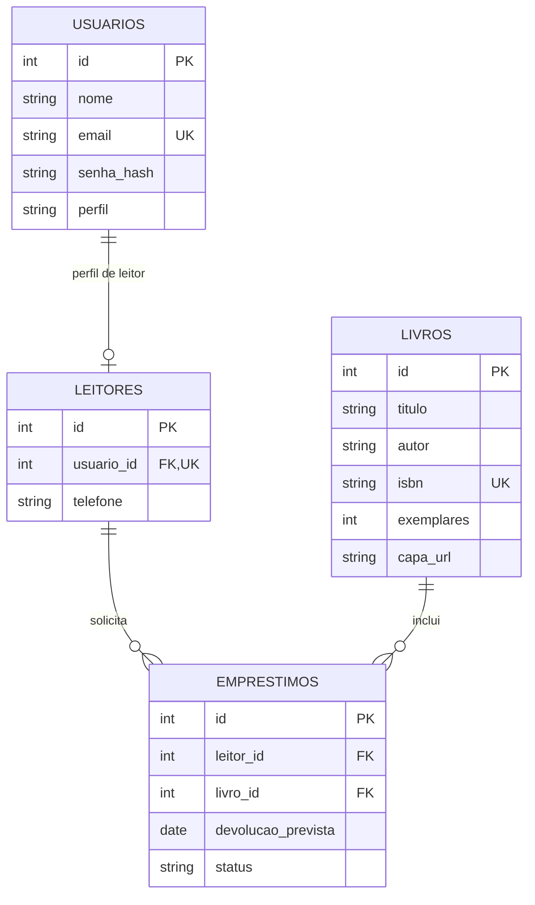

# Biblioteca Aberta

Sistema de biblioteca com catálogo público, consulta de disponibilidade, login por cookie, empréstimo de livros para leitores e gestão do acervo e devoluções por administradores.

## Requisitos

- Node.js 18 ou superior
- PostgreSQL 14 ou superior

## Instalação e execução

1. Crie o banco: `CREATE DATABASE biblioteca_aberta;`
2. No pgAdmin ou `psql`, conecte-se ao banco `biblioteca_aberta` e execute `documentacao/biblioteca4.sql`. Esse script apaga e recria as tabelas; não o execute sobre dados que deseja preservar.
3. Configure `backend/.env` com `DB_HOST`, `DB_PORT`, `DB_USER`, `DB_PASSWORD` e `DB_NAME=biblioteca_aberta`.
4. No terminal, entre na pasta `backend` e instale as dependências com `npm install`.
5. Ainda em `backend`, inicie o servidor com `npm start` e acesse `http://localhost:3001`.
6. Verifique a conexão ao banco em `http://localhost:3001/health`.

## Contas de demonstração

Cada conta de demonstração tem uma senha aleatória de seis dígitos, formada pelos números de 1 a 6. Consulte as senhas fornecidas junto com a atualização do banco; não reutilize essas credenciais em produção.

- Administração: `admin@biblioteca.local`
- Leitor: `ana@biblioteca.local`

Troque essas credenciais antes de qualquer implantação pública. O arquivo SQL contém hashes PBKDF2 para a senha de demonstração, nunca a senha em texto puro.

## Páginas

- `/` — tela de login da biblioteca.
- `/frontend/cadastro.html` — cadastro de uma nova conta de leitor.
- `/catalogo.html` — catálogo, pesquisa e solicitação de empréstimo.
- `/login.html` — atalho para a mesma autenticação.
- `/emprestimos.html` — empréstimos e devolução do leitor autenticado.
- `/livros.html` — CRUD administrativo de livros, inclusive cadastro/exibição da URL da capa.
- `/admin-emprestimos.html` — visão administrativa e registro de devoluções.
- Após entrar, o cookie `HttpOnly` mantém a sessão por até 8 horas enquanto o servidor estiver ativo, e a navegação exibe o nome e o perfil do usuário autenticado. O cookie contém apenas um identificador aleatório; os dados da sessão ficam na memória do servidor. Reiniciar o servidor encerra as sessões ativas.

## API

- `POST /api/auth/register`, `POST /api/auth/login`, `POST /api/auth/logout`, `GET /api/auth/me`
- `GET /api/livros?busca=...`, `POST /api/livros`, `PUT /api/livros/:id`, `DELETE /api/livros/:id`
- `GET /api/emprestimos`, `POST /api/emprestimos`, `PUT /api/emprestimos/:id/devolver`

Rotas de escrita do catálogo requerem perfil administrador; empréstimos requerem sessão de leitor. O cookie da sessão é `HttpOnly`, `SameSite=Lax` e `Secure` em produção.

## Modelo relacional

`livros` é a tabela independente; `usuarios` e `leitores` implementam o relacionamento 1:1 por `UNIQUE (usuario_id)`; um `leitor` pode possuir vários `emprestimos` (1:N). O livro também se relaciona a vários empréstimos. A disponibilidade é calculada a partir dos exemplares e empréstimos ativos.

## Estrutura

- `backend/routes/`: mapeamento dos endpoints.
- `backend/controllers/`: autenticação e regras de negócio.
- `backend/middleware/auth.js`: sessão e autorização por perfil.
- `backend/database.js`: pool PostgreSQL alimentado por variáveis de ambiente.
- `frontend/`: páginas semânticas e CSS externo.
- `documentacao/biblioteca4.sql`: DDL e carga inicial.

## Entrega acadêmica

Antes de entregar, substitua `[Nome completo do aluno]` no rodapé das páginas pelo nome completo real do aluno (a turma M32 já está preenchida). Ajuste o nome do repositório ao padrão solicitado pelo professor, por exemplo `NomeDoAluno_3bim_BibliotecaAberta`, e adicione `rjhalmeman@gmail.com` como colaborador pelo GitHub. Não envie `.env` nem credenciais reais ao repositório.
